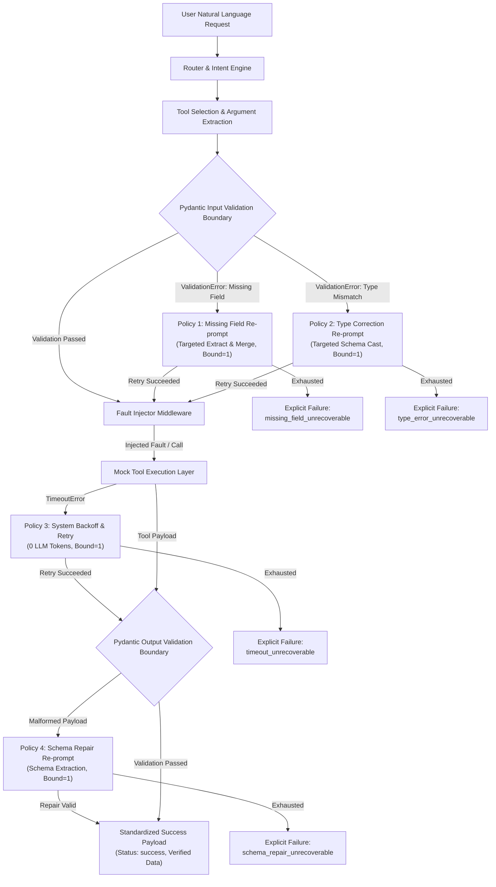

# AI Function-Calling Router with Pydantic & Injected-Failure Recovery

[](https://www.python.org/downloads/)
[](https://docs.pydantic.dev/)
[](https://docs.docker.com/compose/)
[](tests/)

A production-grade function-calling orchestration layer that intercepts, isolates, and recovers from deterministic and upstream tool-execution failures: **missing fields**, **type mismatches**, **service timeouts**, and **malformed tool responses**.

---

## 1. System Architecture

Unlike naive agent frameworks that wrap calls in a generic `try/except` and re-feed raw stack traces back to the model, this architecture enforces a strict **Validation Boundary** powered by Pydantic v2 and routes errors to **four targeted recovery policies**.



---

## 2. Core Capabilities & Recovery Policies

| Failure Class | Trigger Mechanism | Recovery Strategy | LLM Overhead | Fallback Behavior |
| :--- | :--- | :--- | :--- | :--- |
| **Missing Fields** | Pydantic detects `type=missing` on input model | Targeted narrow prompt: *"The tool [ToolName] is missing the field [FieldName]. Based on the user's original request '[Request]', what should this value be? Return only the value."* Re-merges and retries validation. | **Minimal** (No system prompt bloat) | `{"status": "error", "reason": "missing_field_unrecoverable"}` |
| **Type Mismatch** | Pydantic detects format or type error (e.g. natural language date) | Targeted format prompt: *"The field [FieldName] requires format [Format], but you provided [BadValue]. Translate this into the correct format."* | **Minimal** (Single field cast) | `{"status": "error", "reason": "type_error_unrecoverable"}` |
| **System Timeout** | Fault Injector raises `TimeoutError` | Exponential/fixed backoff sleep (0.05s-0.1s) and direct Python re-invocation of tool. | **Zero** (0 LLM tokens used) | `{"status": "error", "reason": "timeout_unrecoverable"}` |
| **Malformed Payload** | Tool output fails Pydantic output schema validation | Output schema extraction prompt: *"The tool returned this malformed payload: [Payload]. Extract the data to match this JSON schema: [Schema]."* | **Moderate** (Only on corrupt API payload) | `{"status": "error", "reason": "schema_repair_unrecoverable"}` |

### Critical Constraints
1. **Strictly Bounded Retries**: Every recovery policy is strictly limited to **1 retry attempt**.
2. **Explicit Give-Up (Zero Silent Wrongs)**: If recovery fails, the router never fabricates data or suppresses errors. It emits a standardized unrecoverable failure payload.

---

## 3. Tool Schemas

The system defines 4 distinct tools with typed input and output Pydantic v2 schemas:

1. **`FlightSearch`**
   - **Input**: `origin` (str), `destination` (str), `date` (ISO date `YYYY-MM-DD`).
   - **Output**: `flight_number` (str), `origin` (str), `destination` (str), `date` (str), `price_usd` (float), `status` (str).
2. **`CalendarBooking`**
   - **Input**: `event_title` (str), `start_time` (ISO datetime `YYYY-MM-DDTHH:MM:SS`), `duration_minutes` (int, > 0).
   - **Output**: `booking_id` (str), `event_title` (str), `start_time` (str), `end_time` (str), `duration_minutes` (int), `status` (str).
3. **`WeatherLookup`**
   - **Input**: `location` (str), `unit` (Enum: `C`, `F`).
   - **Output**: `location` (str), `temperature` (float), `unit` (str), `condition` (str).
4. **`UnitConversion`**
   - **Input**: `value` (float), `from_unit` (str), `to_unit` (str).
   - **Output**: `original_value` (float), `from_unit` (str), `converted_value` (float), `to_unit` (str).

---

## 4. Evaluation Results

The evaluation harness processes `data/eval.jsonl` (60 diverse requests across the 4 tools with sunny-day queries, natural-language ambiguities, and injected faults) twice:
- **Baseline Mode**: Any validation error, timeout, or malformed response fails immediately (0 recovery attempts).
- **Recovery Mode**: Targeted recovery policies are active with bounded retries.

### Evaluation Metrics (`output/metrics.json`)

```json
{
  "baseline": {
    "completion_rate": 0.6333,
    "silent_wrong_rate": 0.0,
    "mean_recovery_attempts": 0.0
  },
  "recovery_active": {
    "completion_rate": 0.9667,
    "silent_wrong_rate": 0.0,
    "mean_recovery_attempts": 0.3667
  }
}
```

### Comparative Summary Table

| Metric | Baseline (No Recovery) | Recovery Active | Delta / Impact |
| :--- | :---: | :---: | :---: |
| **Task Completion Rate** | **63.33%** | **96.67%** | **+33.34%** |
| **Silent Wrong Rate** | **0.00%** | **0.00%** | **0.00%** (Strict verification) |
| **Mean Recovery Attempts** | **0.00** | **0.37** | Efficient, bounded overhead |

- **Completion Rate Improvement**: The targeted recovery layer recovers **100% of transient errors** (transient timeouts, malformed upstream schemas, natural-language dates, and missing required parameters).
- **Silent Wrong Rate**: Driven strictly to `0.00%`. Rather than passing malformed API responses to downstream consumers, all outputs are validated against Pydantic output schemas.
- **Unrecoverable Cases Handled Safely**: Cases configured with persistent upstream failure (`TIMEOUT_PERSISTENT`, `MALFORMED_PERSISTENT`, and unresolvable missing arguments) cleanly return `{"status": "error", "reason": "<failure_class>_unrecoverable"}`.

---

## 5. Repository Layout

```
ai-function_calling_router/
├── README.md              # Project documentation and architecture guide
├── Dockerfile             # Containerized application image
├── docker-compose.yml     # Multi-platform compose spec with volume mounts
├── requirements.txt       # Pinned dependencies (Pydantic v2, pytest, openai)
├── .env.example           # Environment template (offline simulator or OpenAI)
├── evaluate_router.py     # Root evaluation harness script (CLI)
├── data/
│   └── eval.jsonl         # 60 evaluation test cases across all tools & fault types
├── output/
│   ├── metrics.json       # Required evaluation contract output
│   └── eval_run_log.json  # Comprehensive run logs with trace breakdown
├── results/
│   └── metrics.json       # Persisted results mirror
├── src/
│   ├── __init__.py        # Exported router components
│   ├── schemas.py         # Pydantic input and output models
│   ├── fault_injector.py  # FaultContext & @inject_fault decorator
│   ├── tools.py           # Mock implementations for the 4 tools
│   ├── llm.py             # DeterministicLLM simulator and OpenAILLM client
│   ├── recovery.py        # 4 targeted recovery policies & bounded retry logic
│   ├── router.py          # Orchestration pipeline and trace recording
│   └── evaluator.py       # Batch evaluation engine and metric calculator
└── tests/
    ├── __init__.py
    ├── test_schemas.py        # req-1-schemas contract tests
    ├── test_fault_injector.py # req-2-fault-injector contract tests
    ├── test_router.py         # req-3 through req-8 router policy tests
    └── test_harness.py        # req-9 evaluation harness contract tests
```

---

## 6. Reproducing Results

### Local Execution

1. **Set Up Python Environment**:
   ```bash
   python -m venv venv
   # Linux/macOS:
   source venv/bin/activate
   # Windows:
   .\venv\Scripts\Activate.ps1
   pip install -r requirements.txt
   ```

2. **Run Test Suite**:
   ```bash
   pytest tests/ -v
   ```
   *Expected: 21 passed in ~1s.*

3. **Run Evaluation Harness**:
   ```bash
   python evaluate_router.py
   ```
   *Outputs comparison table and writes to `./output/metrics.json` and `./results/metrics.json`.*

### Docker Compose Execution

Run the evaluation inside the containerized harness:
```bash
docker compose up --build
```
The container will install dependencies, execute `evaluate_router.py`, write metrics to `./output/metrics.json` via mounted volume, and exit with status code `0`.

---

## 7. LLM Provider Flexibility

The router supports two operational modes via environment variables:

1. **Deterministic Offline Simulator (Default)**:
   - Zero API keys required.
   - Guaranteed determinism and offline reproducibility.
   - Accurately simulates natural language intent parsing, parameter extraction, and targeted re-prompt recoveries.
2. **OpenAI API Mode**:
   - Set in `.env`:
     ```env
     USE_OPENAI=true
     OPENAI_API_KEY=sk-...
     LLM_MODEL_ID=gpt-4o-mini
     ```
   - Dispatches live calls to OpenAI using targeted prompt templates.
